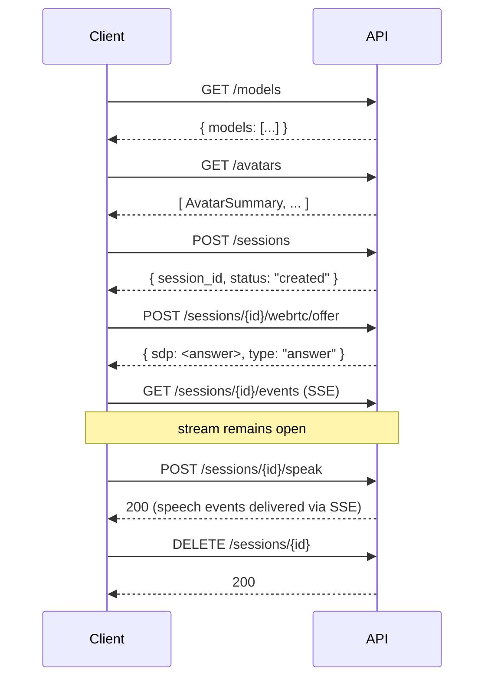

# API Interfaces

## Personal center endpoints

| Method | Path | Description |
| --- | --- | --- |
| `GET` | `/account/profile` | Read own profile |
| `PUT` | `/account/profile` | Update nickname and signature |
| `GET` | `/account/avatar` | Read own account picture |
| `POST` | `/account/avatar` | Upload and normalize account picture |
| `DELETE` | `/account/avatar` | Remove account picture |
| `POST` | `/account/password` | Verify current password and change it |
| `GET` | `/billing/activity` | Own latest 100 task settlements |

OpenTalking exposes a REST, Server-Sent Events, and WebSocket interface defined in
`backend/apps/api/modules/`. The interface is organized into the following groups:

| Group | Purpose | Documentation |
|-------|---------|--------------|
| Health and Models | Liveness probes, queue introspection, and capability discovery. | [Health and Models](health.md) |
| Avatars | Avatar bundle catalog and custom avatar upload. | [Avatars](avatars.md) |
| Sessions | Session lifecycle, conversational interaction, WebRTC signaling. | [Sessions](sessions.md) |
| Streaming outputs | RTMPS/WHIP publishing, WHEP playback, and the local test harness. | [Streaming outputs](streaming.md) |
| TTS and Voices | One-off TTS preview and cloned voice management. | [TTS and Voices](tts-and-voices.md) |
| Events and Streaming | Server-Sent Events stream and audio WebSocket protocol. | [Events and Streaming](events.md) |

## Base URL and authentication

The default base URL is `http://localhost:8000`; the frontend normally uses the same-origin
`/api` proxy. Phone and administrator authentication is enabled by default, using
HttpOnly session cookies. `/auth/status`, SMS/login endpoints and `/healthz` are public;
other business routes require authentication. Administrator routes and runtime-setting
changes require the administrator role. See [account configuration](../../usage/authentication.md).

The `OPENTALKING_CORS_ORIGINS` environment variable controls which origins may issue
cross-origin requests; see [Configuration §3](../../tutorials/configuration.md#3-production-deployment).

## Request and response conventions

Unless otherwise noted, request and response bodies use `application/json`. Multipart
uploads (`multipart/form-data`) are used by avatar and voice-cloning endpoints.

- Successful responses return HTTP `200` with a JSON body.
- Validation errors return HTTP `400` with a `{"detail": "..."}` payload.
- Missing resources return HTTP `404`.
- Authentication and authorization errors raised by upstream services (DashScope, OmniRT) are translated to HTTP `502` with the upstream error text in `detail`.
- Server-side errors return HTTP `500` with a generic message; the actual exception is logged.

Identifier formats:

- `session_id` — UUID4 string assigned at session creation.
- `avatar_id` — slug-format string (alphanumeric, hyphen, underscore, CJK characters), as defined by the avatar's `manifest.json`.
- `voice entry_id` — integer primary key from the SQLite voice catalog.
- `job_id` — UUID4 string assigned to a FlashTalk offline bundle job.

## Endpoint summary

| Method | Path | Group |
|--------|------|-------|
| `GET` | `/auth/status` | Authentication |
| `POST` | `/auth/sms` | Authentication |
| `POST` | `/auth/login` | Authentication |
| `POST` | `/auth/password/login` | Authentication |
| `POST` | `/auth/admin/login` | Authentication |
| `GET` | `/auth/me` | Authentication |
| `POST` | `/auth/logout` | Authentication |
| `GET` | `/admin/overview` | Administration |
| `GET` | `/billing/me` | Membership and ledger |
| `GET` | `/billing/plans` | Membership and ledger |
| `GET` | `/billing/orders` | Membership and ledger |
| `POST` | `/billing/orders` | Membership and ledger |
| `POST` | `/billing/orders/{order_id}/cancel` | Membership and ledger |
| `POST` | `/billing/orders/{order_id}/demo-pay` | Simulated payment, off by default |
| `POST` | `/admin/billing/orders/{order_id}/demo-confirm` | Administrator demo approval, off by default |
| `POST` | `/admin/billing/orders/{order_id}/demo-revoke` | Administrator demo revocation, off by default |
| `GET` | `/billing/usage` | Membership and ledger |
| `GET` | `/admin/billing` | Membership and ledger |
| `PUT` | `/admin/billing/plans/{plan_id}` | Membership and ledger |
| `POST` | `/admin/billing/orders/{order_id}/confirm` | Membership and ledger |
| `POST` | `/admin/billing/orders/{order_id}/refund` | Membership and ledger |
| `POST` | `/admin/billing/gifts` | Membership and ledger |
| `GET` | `/health` | Health and Models |
| `GET` | `/healthz` | Health and Models |
| `GET` | `/queue/status` | Health and Models |
| `GET` | `/models` | Health and Models |
| `GET` | `/avatars` | Avatars |
| `GET` | `/avatars/{avatar_id}` | Avatars |
| `GET` | `/avatars/{avatar_id}/preview` | Avatars |
| `POST` | `/avatars/custom` | Avatars |
| `DELETE` | `/avatars/{avatar_id}` | Avatars |
| `POST` | `/sessions` | Sessions |
| `POST` | `/sessions/customize` | Sessions |
| `POST` | `/sessions/customize/prompt` | Sessions |
| `POST` | `/sessions/customize/reference` | Sessions |
| `GET` | `/sessions/{session_id}` | Sessions |
| `POST` | `/sessions/{session_id}/start` | Sessions |
| `POST` | `/sessions/{session_id}/speak` | Sessions |
| `POST` | `/sessions/{session_id}/transcribe` | Sessions |
| `POST` | `/sessions/{session_id}/speak_audio` | Sessions |
| `POST` | `/sessions/{session_id}/speak_flashtalk_audio` | Sessions |
| `POST` | `/sessions/{session_id}/interrupt` | Sessions |
| `POST` | `/sessions/{session_id}/webrtc/offer` | Sessions |
| `POST` | `/sessions/{session_id}/flashtalk-recording/start` | Sessions |
| `POST` | `/sessions/{session_id}/flashtalk-recording/stop` | Sessions |
| `GET` | `/sessions/{session_id}/flashtalk-recording` | Sessions |
| `POST` | `/sessions/{session_id}/flashtalk-offline-bundle` | Sessions |
| `GET` | `/sessions/{session_id}/flashtalk-offline-bundle/{job_id}` | Sessions |
| `GET` | `/sessions/{session_id}/flashtalk-offline-bundle/{job_id}/download` | Sessions |
| `DELETE` | `/sessions/{session_id}` | Sessions |
| `WS` | `/sessions/{session_id}/speak_audio_stream` | Events and Streaming |
| `GET` | `/sessions/{session_id}/events` | Events and Streaming |
| `POST` | `/tts/preview` | TTS and Voices |
| `GET` | `/voices` | TTS and Voices |
| `POST` | `/voices/clone` | TTS and Voices |
| `DELETE` | `/voices/{entry_id}` | TTS and Voices |

## Typical request sequence

A complete client interaction typically follows the sequence below.

## OpenAPI specification

A complete OpenAPI 3.x specification is generated by FastAPI and is available at the
following endpoints:

- Interactive documentation (Swagger UI): `<base>/docs`
- Alternative interactive documentation (ReDoc): `<base>/redoc`
- Raw specification (JSON): `<base>/openapi.json`

The OpenAPI specification is authoritative for exact field-level types and validation
rules. Generated client SDKs and integration tests should source their definitions
from the specification rather than this documentation.

## Source files

| File | Routes |
|------|--------|
| `backend/apps/api/modules/system/health.py` | `/health`, `/healthz`, `/queue/status` |
| `backend/apps/api/modules/system/models.py` | `/models` |
| `backend/apps/api/modules/avatars/router.py` | `/avatars/*` |
| `backend/apps/api/modules/conversation/sessions.py` | `/sessions/*` |
| `backend/apps/api/modules/voices/preview.py` | `/tts/preview` |
| `backend/apps/api/modules/voices/router.py` | `/voices`, `/voices/clone`, `/voices/{entry_id}` |
| `backend/apps/api/modules/conversation/events.py` | `/sessions/{id}/events` (SSE) |
| `backend/apps/api/modules/conversation/schemas.py` | Request and response models for sessions. |
| `backend/apps/api/modules/avatars/schemas.py` | `AvatarSummary` response model. |

## Additional current business endpoints

| Method | Path | Description |
| --- | --- | --- |
| `GET` | `/avatars/{avatar_id}/client-assets/{asset_path}` | Get Client Asset |
| `GET` | `/avatars/{avatar_id}/client-renderer` | Get Client Renderer |
| `PATCH` | `/avatars/{avatar_id}/person-mode` | Update Avatar Person Mode |
| `GET` | `/avatars/{avatar_id}/preview-video` | Get Preview Video |
| `POST` | `/avatars/{avatar_id}/prewarm` | Prewarm Avatar |
| `GET` | `/exports/videos` | List Export Videos |
| `POST` | `/exports/videos` | Upload Export Video |
| `DELETE` | `/exports/videos/{export_id}` | Delete Export Video |
| `GET` | `/exports/videos/{export_id}` | Get Export Video |
| `GET` | `/exports/videos/{export_id}/download` | Download Export Video |
| `GET` | `/runtime-config` | Get Runtime Config |
| `POST` | `/runtime-config/apply` | Apply Runtime Config |
| `GET` | `/runtime/status` | Runtime Status |
| `GET` | `/sessions/webrtc/ice-config` | Webrtc Ice Config |
| `POST` | `/sessions/{session_id}/fasterliveportrait-config` | Update Fasterliveportrait Config |
| `POST` | `/sessions/{session_id}/knowledge-bases` | Update Session Knowledge Bases |
| `POST` | `/tts/preview-duo-dialog` | Preview Duo Dialog Tts |
| `POST` | `/video-creation/jobs` | Create Video Creation Job |
| `DELETE` | `/video-creation/jobs/{job_id}` | Delete Video Creation Job |
| `GET` | `/video-creation/jobs/{job_id}` | Get Video Creation Job |
| `POST` | `/video-creation/jobs/{job_id}/stop` | Stop Video Creation Job |

## Knowledge and explicit memory

See [usage guide](../../usage/knowledge-memory.md).

| Method | Path |
| --- | --- |
| `GET` | `/knowledge/bases` |
| `POST` | `/knowledge/bases` |
| `DELETE` | `/knowledge/bases/{kb_id}` |
| `GET` | `/knowledge/bases/{kb_id}/documents` |
| `POST` | `/knowledge/bases/{kb_id}/documents` |
| `DELETE` | `/knowledge/bases/{kb_id}/documents/{doc_id}` |
| `POST` | `/knowledge/bases/{kb_id}/documents/{doc_id}/retry` |
| `POST` | `/knowledge/bases/{kb_id}/query` |
| `GET` | `/knowledge/memories` |
| `POST` | `/knowledge/memories` |
| `PUT` | `/knowledge/memories/{memory_id}` |
| `DELETE` | `/knowledge/memories/{memory_id}` |
